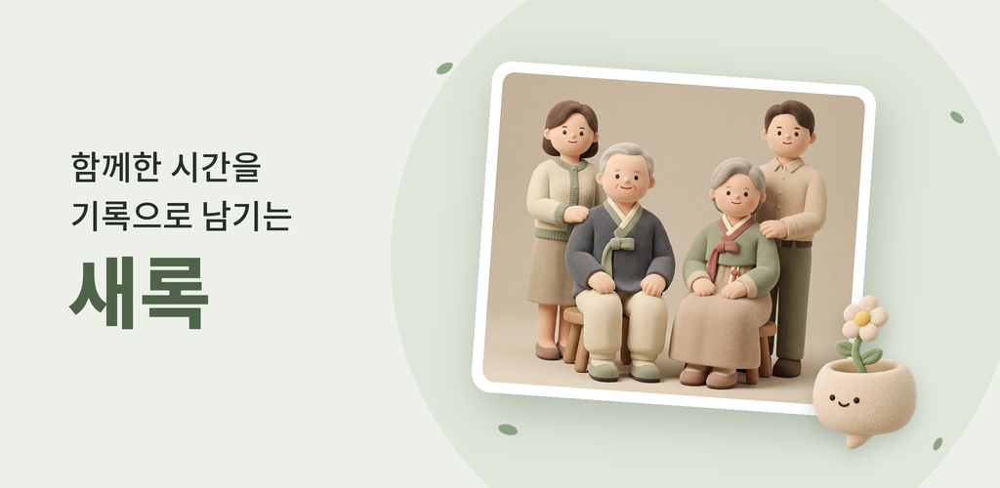
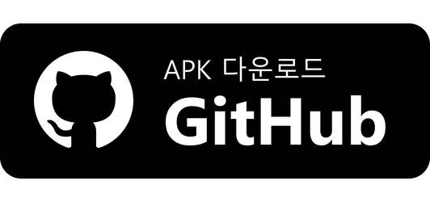
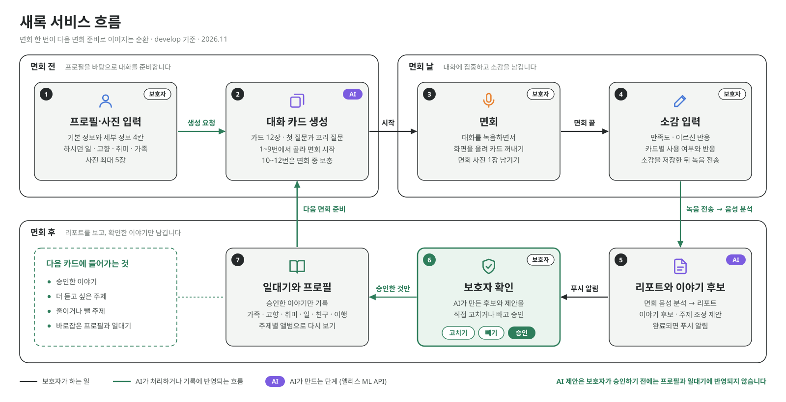
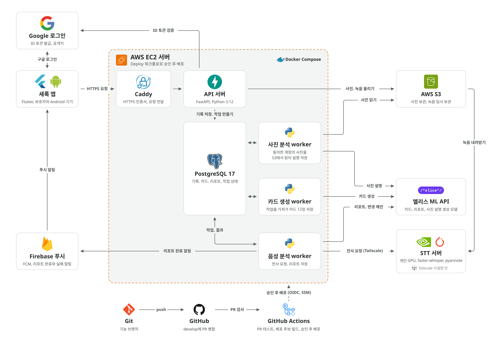
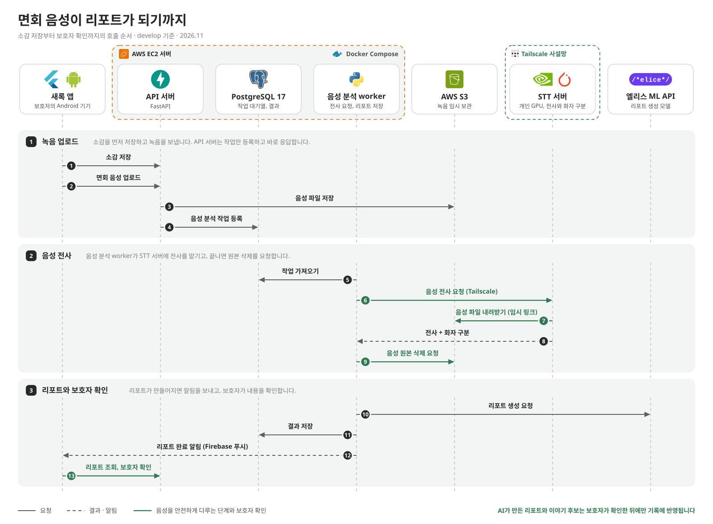
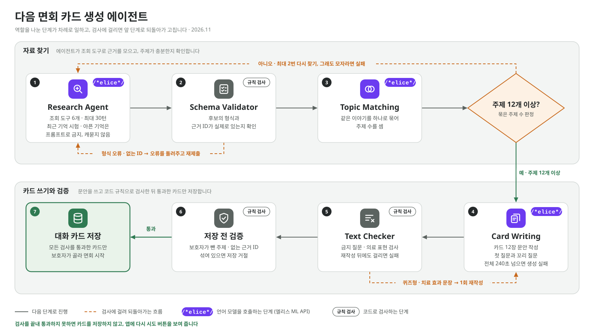

# 💬 새록: 똑똑한 면회 도구

     
<!--  -->

<!-- 📐 배너: 플레이콘솔업로드용/feature-1024x500.png를 옮겨 둔 것. 반영 전에 webp로 바꾸면 용량이 줄어든다. -->

## AI 기반 면회 및 대화 지원 프로그램
**면회 전엔 대화 카드로 이야기를 준비하고, 면회 후엔 함께한 시간을 기록으로 남기기**

<!-- 📐 한 줄 소개: 스토어 "간단한 설명" 그대로. -->

<!-- 📐 배지 줄: Play 게시 전에는 "Play 검토 중", 게시 뒤 스토어 링크로 바꾼다. 원스토어는 공개 링크(m.onestore.co.kr), 최신 develop APK가 필요하면 GitHub Releases 링크를 따로 단다. 수상 배지는 결과가 나온 뒤에만 단다. -->

<!-- 📐 의료 고지는 배너 바로 아래 고정. "기억력 향상", "치매 예방" 같은 효과 표현은 README 어디에도 쓰지 않는다.
     GitHub 강조 상자(> [!IMPORTANT])는 다른 요소 안에서는 상자로 그려지지 않을 수 있어 가운데 정렬 div 밖에 둔다.
     상자 종류: NOTE(파랑) / TIP(초록) / IMPORTANT(보라) / WARNING(노랑) / CAUTION(빨강) -->

> [!TIP]
> **새록은 보호자를 위한 면회 대화 지원 도구이며, 의료 서비스는 아닙니다.**
>
> - 🩺 진단, 치료, 기억 회복을 제공하지 않습니다.
> - 📄 보호자가 면회 대화를 준비하고 기록하도록 돕습니다.
> - 📖 보호자가 확인한 이야기만 어르신의 일대기로 모아 줍니다.

---

### 🎬 시연 영상

<!--
📐 시연 영상 자리 (아직 없음, 지금 README 기준 [계획])
- 길이 1분 30초 안팎. develop 빌드 APK, 데모 페르소나 계정, 실기기 화면 녹화.
- 순서: 홈 → 대화 카드 고르기 → 면회 녹음 중 카드 꺼내기 → 소감 → 리포트 완료 푸시 → 리포트 → 이야기 후보 확인 → 일대기
- 녹음 장면의 음성은 팀원이 대본을 읽은 합성 대화만 쓴다.
- 넣는 법 A (추천): 이슈나 PR 댓글 입력창에 mp4를 끌어 놓아 생긴 https://github.com/user-attachments/assets/... 주소를
  아래 한 줄에 그대로 붙인다. 그러면 README 안에서 바로 재생된다. 파일 크기 제한이 있으니(무료 플랜 10MB) 720p로 압축한다.
- 넣는 법 B: YouTube 일부 공개 + 썸네일 이미지 링크
  
- 영상이 나오기 전에는 연결형 스크린샷을 임시로 둔다. 단 기존 이미지의 리포트 화면에 "전사에는 …" 문구가 있으므로
  (#273 이후 보호자에게 보이는 글에 처리 과정의 말을 쓰지 않음) 다시 캡처한 것으로 바꾼다.
-->

https://github.com/user-attachments/assets/6d12bdbd-5db5-4738-90bf-acb7acb7d49a

---

### 💡새록의 주요 기능

<!-- 📐 핵심 가치 표: 문구 출처는 플레이콘솔업로드용/스토어등록정보_문구.txt의 첫 문단과 "이런 분께 필요해요". 대상 범위는 PM 제품 기준과 맞는지 PM 확인. -->

|            핵심 기능            | 설명                                                                         |
| :-----------------------------: | ---------------------------------------------------------------------------- |
|      **이야기를 준비합니다**      | 부모님이 살아오신 이야기와 사진으로 대화 카드를 만들어 면회 대화를 미리 준비 |
|     **대화에만 집중합니다**       | 녹음하면서도 준비한 카드를 바로 꺼내 보고, 새록은 대화에 끼어들지 않음       |
| **보호자가 확인한 것만 남깁니다** | 면회 리포트와 이야기 후보 중 보호자가 확인한 것만 일대기와 다음 대화에 반영  |

---

**개발기간**: 2026년 9월 ~ 2026년 11월 (3개월)

---

## 바로가기 링크

- 🚀 **배포**:
     - 
     - 
     - 

- 🗂️ **협업 공간**: [팀 노션 페이지](https://app.notion.com/p/elice-track/2-32a2bb98425783f789d581889bd816e4?p=3bb2bb98425780578cf2e7b7ba204ba9&pm=s)
  
- 📋 **가이드 문서**: [개발자 가이드](https://saerok-docs.vercel.app/docs/portal/)

---

## 목차

<!-- 📐 제목에 이모지를 넣으면 GitHub 앵커가 깨지기 쉬우므로 본문 제목(##)에는 이모지를 쓰지 않고 목차에만 쓴다.
     오른쪽 열은 참고 README의 Git 규칙/코드 컨벤션 대신 우리 README의 개발자용 섹션으로 바꿨다. 협업 규칙은 CONTRIBUTING.md가 정본. -->

### 📋 프로젝트 소개

- **[서비스 흐름](#서비스-흐름)** - 면회가 다음 면회로 이어지는 순환
- **[주요 기능](#주요-기능)** - 5가지 핵심 기능 소개
- **[개발 결과와 검증](#개발-결과와-검증)** - 기획 대비 구현과 검증 기록
- **[새록이 지키는 것](#새록이-지키는-것)** - AI와 개인정보 원칙
- **[시스템 아키텍처](#시스템-아키텍처)** - 시스템 구조와 음성 처리 순서
- **[Agentic AI 설계](#agentic-ai-설계)** - 모델 선정, 카드 생성 에이전트, 안전장치와 품질 개선
- **[기술 스택](#기술-스택)** - 사용된 기술 및 도구
- **[팀원](#팀원)** - 새록 개발 팀

---

## 서비스 흐름

<!-- 📐 서비스 흐름 그림: docs/assets/saerok-service-flow.svg (1600×820, 14KB). 아키텍처 그림과 같은 스타일. 저장소에 커밋해야 README에 보인다.
     면회 전(1~2) → 면회 날(3~4) → 면회 후(5~7) → 다음 면회 준비(7→2)의 순환. 6번 보호자 확인을 초록으로 강조해 승인 전에는 반영하지 않는다는 점을 드러낸다.
     카드 12장, 사진 5장 같은 숫자는 코드가 바뀌면 그림도 고친다. 원본 생성 스크립트는 없으니 SVG 글자를 직접 고친다.
     배경이 흰색이라 다크 모드에서는 흰 카드로 보인다. -->

  

> AI가 만든 이야기 후보는 보호자가 확인한 것만 일대기와 다음 대화 카드에 반영됩니다.

---

## 주요 기능

<!-- 📐 기능 5개를 같은 형식으로 반복: 왼쪽 시연 영상(width 260), 오른쪽 설명.
     참고 README의 PC/모바일 2열 대신 화면 1개 + 설명 2열로 둔다(모바일 앱이라).
     영상 원본은 docs/assets/*.mp4. GitHub는 저장소 안의 mp4를 README에서 재생하지 않는다(링크로만 보이거나 아무것도 안 보임).
     README에 반영할 때 각 mp4를 이슈·PR 댓글 입력창에 끌어 놓아 생긴 https://github.com/user-attachments/assets/... 주소로
     <video src="...">를 바꾼다. 그러면 mp4는 저장소에 커밋하지 않아도 된다(7개 합계 약 39MB).
     영상은 데모 페르소나·합성 자료만 담겨 있어야 한다. 리포트 문구에 처리 과정의 말(전사, 화자, 라벨)이 없는지 확인.
     [미구현] 기능(사진 삭제 버튼, 백그라운드 녹음 유지 등)은 쓰지 않는다. -->

### 1. 대화 카드로 미리 준비합니다

<table>
<tr>
<td width="40%" align="center">
  <!-- 📐 영상: docs/assets/새록_대화카드준비.mp4 (5.3MB) → user-attachments 주소로 교체 -->

https://github.com/user-attachments/assets/d7414136-7bc9-445d-a815-8a4690103906

</td>
<td width="60%" valign="middle">

> **생애 정보와 사진으로 만드는 대화 카드** 
> 프로필에 입력한 하시던 일, 고향, 취미, 가족 이야기와 등록한 사진을 바탕으로 카드를 만듭니다

> **보호자가 직접 고릅니다** 
> 카드 12장 중 1~9번에서 골라 면회를 시작하고, 이야기가 더 필요하면 카드를 추가합니다

> **첫 질문과 꼬리 질문** 
> 카드마다 대화를 여는 질문과 이어 갈 질문이 함께 들어 있습니다

</td>
</tr>
</table>

 

### 2. 면회 중엔 대화에만 집중합니다

<table>
<tr>
<td width="40%" align="center">
  <!-- 📐 영상: docs/assets/새록_면회중.mp4 (4.9MB) → user-attachments 주소로 교체 -->

https://github.com/user-attachments/assets/95fd7388-a40a-44d9-a6b2-ff3a6700fba0

</td>
<td width="60%" valign="middle">

> **녹음하면서 카드 꺼내기** 
> 면회 대화를 녹음하는 동안 화면을 위로 올려 준비한 카드를 바로 볼 수 있습니다

> **녹음이 끊기지 않게** 
> 녹음하는 동안 화면이 저절로 꺼지지 않고, 앱이 꺼져도 다음 실행 때 녹음을 복구해 보냅니다

> **대화에 끼어들지 않습니다** 
> 이야기가 다른 주제로 흘러가도 괜찮습니다

</td>
</tr>
</table>

 

### 3. 면회가 끝나면 리포트로 돌아봅니다

<!-- 📐 영상 2개를 나란히: 왼쪽 소감 평가, 오른쪽 리포트 결과. 설명은 아래 줄에 한 칸으로 둔다.
     리포트 화면 문구에 처리 과정의 말(전사, 화자, 라벨)이나 효과 표현이 없는지 PM 확인. -->

<table>
<tr>
<td width="50%" align="center">
  <!-- 📐 영상: docs/assets/새록_리포트_평가.mp4 (5.0MB) → user-attachments 주소로 교체 -->

https://github.com/user-attachments/assets/991fd570-a863-4898-86f9-1d7653b32406

</td>
<td width="50%" align="center">
  <!-- 📐 영상: docs/assets/새록_리포트_결과.mp4 (8.1MB) → user-attachments 주소로 교체. 무료 플랜 첨부 한도 10MB에 가까움 -->

https://github.com/user-attachments/assets/0483f036-c5bb-4d33-bb27-dc587568352d

</td>
</tr>
<tr>
<td colspan="2">

> **소감과 대화로 만드는 리포트** 
> 보호자가 남긴 소감과 면회 대화를 바탕으로 오늘의 만남을 정리합니다

> **완료되면 알림** 
> 리포트가 준비되면 푸시 알림을 보내고, 알림을 누르면 리포트가 열립니다

> **다음 면회 준비** 
> 어떤 이야기에 반가워하셨는지 돌아보며 다음 면회를 준비합니다

</td>
</tr>
</table>

 

### 4. 보호자가 확인한 이야기만 일대기로

<table>
<tr>
<td width="40%" align="center">
  <!-- 📐 영상: docs/assets/새록_일대기.mp4 (2.5MB) → user-attachments 주소로 교체.
       영상에 이야기 후보 확인·승인 장면이 없다면 아래 첫 설명("이야기 후보는 확인 뒤에만")에 맞는 장면을 추가하거나 설명 순서를 바꾼다. -->

https://github.com/user-attachments/assets/5a82bb5e-349f-4d12-967c-d0422fa7543c

</td>
<td width="60%" valign="middle">

> **이야기 후보는 확인 뒤에만** 
> AI가 찾은 이야기 후보를 보호자가 고치거나 빼고 승인합니다. 승인 전에는 아무것도 반영되지 않습니다

> **한 권의 일대기** 
> 확인한 이야기는 가족, 고향, 취미, 일, 친구, 여행 주제별로 앨범처럼 쌓입니다

> **다음 대화에 이어집니다** 
> 승인한 이야기와 더 듣고 싶은 주제, 피하고 싶은 주제가 다음 대화 카드에 반영됩니다

</td>
</tr>
</table>

 

### 5. 사진 속 추억과 보기 편한 쉬운 모드

<!-- 📐 영상 2개를 나란히: 왼쪽 사진 분석과 대화 카드, 오른쪽 쉬운 모드 리포트. 영상에 실제 사용자 사진이 없고 생성·합성 이미지만 있는지 확인. -->

<table>
<tr>
<td width="50%" align="center">
  <!-- 📐 영상: docs/assets/새록_대화카드_사진분석.mp4 (9.4MB) → user-attachments 주소로 교체. 무료 플랜 첨부 한도 10MB에 거의 닿음. 넘으면 720p로 다시 압축 -->
  
https://github.com/user-attachments/assets/551d2889-410b-4edd-bbeb-c9d2fae35fc2

</td>
<td width="50%" align="center">
  <!-- 📐 영상: docs/assets/새록_리포트_쉬운모드.mp4 (3.7MB) → user-attachments 주소로 교체 -->

https://github.com/user-attachments/assets/4e4f876d-a6fc-4a0e-8f9c-768875f680bb

</td>
</tr>
<tr>
<td valign="top">

> **사진 속 추억도 이야깃거리로** 
> 어르신마다 사진 5장까지 올리면 AI가 사진 설명을 만들어 대화 소재로 씁니다. AI 사진 분석에 동의한 경우에만 분석하고, 설명은 언제든 고칠 수 있습니다

</td>
<td valign="top">

> **보기 편한 쉬운 모드** 
> 글자를 크게 키워 리포트와 기록을 편하게 읽고, 화면 낭독(TalkBack)도 핵심 흐름에서 쓸 수 있게 보완했습니다

</td>
</tr>
</table>

<!-- 📐 TalkBack은 위젯 테스트만 했고 실기기 확인이 남았다(지금 README 핵심 흐름). 이 문장을 넣을지 FE가 확인. -->

---

## 개발 결과와 검증

처음 기획한 기능을 어떻게 구현했고, 개발 중 무엇을 바꿨는지와 검증 결과를 정리했습니다.

- [서비스 개발 결과 보고서](docs/pm/service-development-fidelity-20261110.md): 최초 기획, 변경 이유, 구현 결과, 실사용 개선과 후속 계획
- [멘토 심사 항목별 근거](docs/pm/mentor-evidence.md): 기능별 테스트와 실행 기록
- [S22 E2E 검증 보고서](docs/qa/s22-e2e-20261111/README.md): 두 회차 운영 연결, 실패 복구, 추가 검사와 미확인 범위
- [상세 문서 안내](docs/README.md): 앱, 서버, AI, API와 기술 결정 문서

---

## 새록이 지키는 것

<!-- 📐 짧은 요약 4줄. 자세한 내용은 아래 개발자용의 "제품 원칙"과 법률 검토로 연결.
     녹음 삭제는 "운영에서 24시간 상한을 강제하는 설정은 아직 없다"는 알려진 제한과 어긋나지 않게 "기준"으로만 쓴다. 문구는 BE·PM 확인. -->

|     | 원칙                                                                  |
| :-: | --------------------------------------------------------------------- |
| 🩺  | 의료 진단, 병세 예측, 치료 효과를 만들지 않습니다                       |
| ✋  | AI 제안은 보호자가 확인하기 전에 프로필과 일대기에 반영하지 않습니다    |
| 💬  | 최근 기억을 시험하는 질문이나 확인되지 않은 생애 정보를 만들지 않습니다 |
| 🔒  | 녹음 원본은 분석이 끝나면 지우는 것을 기준으로 합니다                   |

자세한 원칙은 [제품 원칙](docs/pm/README.md)과 [법률 검토](docs/legal/README.md)에 있습니다.

---

## 시스템 아키텍처

<!-- 📐 아키텍처 그림: docs/assets/saerok-architecture-slide.svg (1600×900, 17KB). 이 SVG는 저장소에 커밋해야 README에 보인다.
     - 배경색(#EEF2EF)이 그림 안에 있어 다크 모드에서도 밝은 카드로 보인다.
     - 글꼴은 보는 사람 PC의 글꼴(Noto Sans KR, 맑은 고딕 등)로 그려지므로 환경에 따라 글자 폭이 조금 달라질 수 있다. GitHub 미리보기에서 글자가 상자를 넘지 않는지 확인.
     - 서버 주소, 인스턴스 정보, 버킷 이름은 넣지 않는다.
     반영 전에 그림 내용과 코드·문서가 맞는지 확인할 것:
     - photo-worker(AI 사진 설명, #257)가 그림에 없다. 엘리스 ML API 상자도 "대화 카드 · 리포트"만 적혀 있는데,
       photo-worker도 같은 ML API를 부른다(backend/app/workers/photo_analysis.py).
     - GitHub 상자의 "서버 수동 갱신"은 지금 README의 "운영 서버 배포는 승인 배포 workflow로 한다"와 다르다.
     - STT 서버 상자의 "처리 후 음성 삭제": S3 녹음 원본 삭제 요청은 speech-worker가 한다(README 호출 흐름 4). STT 서버가 자기 임시 파일을 지우는 뜻이면 그대로 둔다.
     - 예비 STT 전환(#189)은 그림에 없다. 넣을지 BE가 정한다.
     - backend/README.md 3행은 "VLM은 연결되지 않았다"로 남아 있어 따로 정정이 필요하다. -->

  

<!-- 📐 그림 아래 동작 설명: 발표 스크립트 [6. 시스템 구조]를 바탕으로, 그림 상자에 적힌 이름(굵게)을 그대로 쓴다.
     코드 이름(card-worker, speech-worker 등)은 쓰지 않는다. 대응: 대화 카드 생성 프로세스 = card-worker, 음성 분석 프로세스 = speech-worker.
     원본 삭제 요청, 알림 수신 동의는 기존 README 호출 흐름의 사실이라 남겼다. -->

1. **보호자**는 **Android 앱**으로 새록을 사용합니다. 앱의 모든 요청은 **Caddy**를 거쳐 HTTPS로 암호화되어 서버에 들어옵니다.
2. **FastAPI 서버**가 **Google 로그인** 확인, 프로필, 사진과 음성 업로드를 처리하고, 사진과 면회 음성은 **AWS S3 Bucket**에 저장합니다.
3. 시간이 오래 걸리는 AI 작업은 FastAPI 서버가 직접 처리하지 않습니다. 카드 생성이나 음성 분석을 요청하면 **PostgreSQL**의 작업 대기열에 등록만 하고 바로 응답하므로, AI 처리가 오래 걸려도 앱은 멈추지 않습니다.
4. **대화 카드 생성 프로세스**는 대기열에서 작업을 가져가, LangChain으로 구성한 파이프라인으로 **엘리스 ML API**의 언어 모델을 호출해 대화 카드를 만듭니다.
5. **음성 분석 프로세스**는 대기열에서 작업을 가져가 GPU를 쓰는 별도의 **STT 서버**에 전사를 요청합니다. STT 서버는 외부에 열려 있지 않고 Tailscale 사설망으로만 연결되며, 음성 파일은 임시 링크로 내려받습니다.
6. 전사가 끝나면 음성 분석 프로세스가 음성 원본 삭제를 요청하고, 전사 내용으로 리포트와 이야기 후보를 만든 뒤 알림 수신에 동의한 보호자의 앱으로 **Firebase Cloud Messaging** 완료 알림을 보냅니다.
7. 각 프로세스는 역할별 Docker 컨테이너로 나눠 **AWS EC2**에서 운영하고, 코드는 **GitHub**에서 검토를 마친 것만 서버에 반영합니다.

---

## 기능의 흐름 End to End(시퀀스 다이어그램)

<!-- 📐 접어 두는 선택 다이어그램: docs/assets/saerok-speech-sequence.svg (1600×1176). 기존 mermaid 시퀀스와 순서가 같다(13단계).
     순서와 주체는 backend/docs/async-speech-analysis.md와 맞는지 BE 확인. -->

  

---

## Agentic AI 설계

<!-- 📐 출처: 충남대1팀_AI파트.pdf(발표 자료 "Agentic 경험" 4장). 수치는 발표 자료 그대로 옮김
     근거 문서: ai/docs/stt-mobile-benchmark, ai/docs/image_tagging, docs/pm/ai-quality-safety-evidence-20261111.md, evals/results/.
     카드 생성 에이전트의 도구 수(6), 최대 턴(30), 재탐색 횟수(2), 제한 시간(240초)이 코드에서 바뀌면 이 섹션도 고친다.
     실제 면회 녹음은 수치(건수, 길이)만 쓰고 내용은 쓰지 않는다. -->

새록의 AI는 한 번 호출로 끝나지 않습니다. **조회 도구를 쓰며 스스로 자료를 찾는 에이전트**, **결과를 검사해 되돌려 보내는 검증 단계**, **보호자 승인**을 이어 붙여, 확인된 생애 정보만으로 대화 카드와 리포트를 만듭니다.

### 1. 온디바이스를 먼저 검토하고 API로 전환

개인정보 보호를 위해 음성과 사진을 기기 안에서 처리하는 방법을 먼저 실측했지만, 정확도와 기기 자원 부담이 커서 API 방식으로 바꿨습니다.

| 구분 | 측정 내용 | 결과 |
| :-: | --- | --- |
| **STT** | 갤럭시 S21에서 Whisper Small 실행 | 문자 오류율(CER) **18.1%**, 1시간 음성 처리에 **43분** |
| **VLM 품질** | 3B 이하 모델 10종으로 사진 키워드 생성 | **0/10** (모두 품질 미달: 같은 단어 반복, 무관한 영어 출력, 프롬프트 예시 복사 등) |
| **VLM 속도** | 스마트폰에서 사진 1장 인코딩 | **122초**, 처리 중 스마트폰이 멈춤 |
| **메모리** | OS와 앱이 쓰고 남은 유휴 메모리 | 1.5~2.2GB로, 2.6GB가 필요한 3B 모델은 부담 |
| **앱 크기** | 모델 파일을 앱에 함께 배포 | 0.5~2.6GB 증가 |

API로 전환하는 대신 **별도 동의, 전송 암호화, 처리 후 삭제**를 기준으로 개인정보를 보호합니다.
자세한 측정은 [STT 모바일 벤치마크](ai/docs/stt-mobile-benchmark/README.md)와 [VLM 후보 실측](ai/docs/image_tagging/README.md)에 있습니다.

### 2. 성능 대비 비용으로 모델 선정

공개 벤치마크로 후보를 좁히고, 새록의 실제 입력으로 다시 측정했습니다.

- **공개 벤치마크**: 이미지와 표를 함께 이해해야 하는 MMMU-Pro에서 GPT-6 Luna는 **79.7%, 문제당 약 $0.002**입니다. 최고점 모델보다 약 17배, 가장 비싼 모델보다 약 50배 저렴하고 점수 차이는 10%p 이내입니다. (Artificial Analysis, 2026-11-09)

| 역할 | 직접 측정한 결과 |
| :-: | --- |
| **STT** | 서버 Whisper large-v3-turbo, 정답 대본이 있는 한국어 문장 43개 기준 **CER 4.7%** (100자 중 약 5자 오류) |
| **VLM** | 사진 17장 중 품질 A 등급 **Luna 10장 vs Haiku 4.5 2장**, 출력 형식 준수 17/17 vs 15/17 |
| **LLM** | 실제 대화 3건 평균 응답 시간 **GPT-6 Luna 5.85초 vs GPT-5.6 Luna 9.55초**, 출력 단가 $0.50 vs $1.20 |
| **추론 강도** | 실제 면회 녹음으로 3개 설정 비교: 리포트는 `low`, 이야기 후보는 `medium`, `high`는 출력 한도 초과로 제외 |

### 3. 다음 면회 카드를 만드는 에이전트

카드 생성은 역할이 나뉜 단계가 차례로 일하고, 검사에서 걸리면 앞 단계로 되돌아가 고칩니다.

<!-- 📐 카드 생성 에이전트 그림: docs/assets/saerok-card-agent.svg (1600×900). 서비스 흐름 그림과 같은 스타일(구역 #F3F5F4, 번호 원, 아이콘 사각형, /*elice*/ 배지).
     보라 배지 = 언어 모델 호출 단계, "규칙 검사" 배지 = 코드 검사 단계, 주황 점선 = 검사에 걸려 되돌아가는 흐름.
     흰 배경을 그림 안에 넣어 다크 모드에서도 흰 카드로 보인다. 원본 생성 스크립트는 없으니 숫자가 바뀌면 SVG 글자를 직접 고친다. -->

  

| 단계 | 하는 일 | 걸렸을 때 |
| --- | --- | --- |
| **Research Agent** | 조회 도구로 프로필, 승인된 이야기, 사진 설명을 직접 찾아 카드 후보를 모음 | 최근 기억 시험, 아픈 기억은 프롬프트로 금지하고 캐묻지 않음 |
| **Schema Validator** | 후보의 형식과 근거 ID가 실제로 있는지 확인 | 오류 문장을 에이전트에게 돌려주고 다시 제출받음 (앱은 자동 처리) |
| **Topic Matching** | 같은 이야기를 하나로 묶어 주제 수를 셈 | 12개 미만이면 최대 2번 다시 찾고, 그래도 모자라면 실패 처리 |
| **Card Writing** | 주제별로 첫 질문과 꼬리 질문이 있는 카드 12장 작성 | 전체 240초를 넘으면 생성 실패로 처리 |
| **Text Checker** | 금지 질문과 의료 표현을 규칙으로 검사 | 1회 재작성, 또 걸리면 실패 |
| **저장 전 검증** | 보호자가 뺀 주제와 없는 근거가 섞였는지 마지막 확인 | 저장 거절, 생성 실패 |

실패하면 앱에 **다시 시도** 버튼이 보이고, 확인되지 않은 카드는 저장되지 않습니다.

### 4. 3단계로 거르고 실패 지점마다 복구 경로 준비

| 단계 | 방법 |
| :-: | --- |
| ① **시스템 프롬프트** | 생성할 때 금지 규칙으로 1차 차단 |
| ② **코드 검사** | 생성 결과를 규칙으로 검사해 재작성하거나 차단 |
| ③ **보호자 확인** | 보호자가 승인한 결과만 기록에 반영 |
| ⚠️ **장애 복구** | 예비 서버로 자동 전환하거나 앱에서 다시 시도 안내 |

면회 리포트와 이야기 후보는 `녹음 업로드 → STT 서버(Whisper, 화자 분리) → 리포트·이야기 후보 생성 → Safety Validator → 보호자 승인 → 일대기 저장` 순서로 만들어지며, 각 지점의 실패를 이렇게 처리합니다.

| 실패 지점 | 처리 | 앱에서 |
| --- | --- | --- |
| 녹음 업로드 실패 | 녹음은 기기에 보관 | 녹음 다시 보내기 |
| STT 서버 연결 실패 | 예비 STT 서버로 전환 | 자동 처리, 조치 없음 |
| 무음, 환각 문장 | 필터 후 빈 전사면 중단 | 실패 알림, 녹음 재전송 |
| LLM 장애, 시간 초과 | 리포트 생성 실패 | 전사로 재요청 (3회까지) |
| 의료 효과를 단정하는 문장 | 리포트 저장 차단 | 실패 알림, 분석 재요청 |
| 지어낸 이야기, 잘못 알아들은 내용 | 승인 전에는 일대기에 반영하지 않음 | 보호자가 승인 또는 거절 |

### 5. 찾고 고치고 같은 입력으로 재검토

페르소나 시뮬레이션(가상 어르신·보호자 LLM으로 8회차), 합성·공개 데이터(운영 서버 44회, STT 정답 문장 43개), 동의받은 가족 면회 녹음 1건(88분)을 입력으로 넣고, **규칙 기반 자동 검사**(필수 사실, 금지어, 형식, 의료 표현)와 **사람 확인**(출력 정독, 녹음 당사자 확인)으로 문제를 찾았습니다. 원인을 분석해 프롬프트나 로직을 고친 뒤 같은 입력으로 재검증했습니다.

| 발견 경로 | 문제 | 수정 | 전 → 후 |
| :-: | --- | --- | --- |
| 시뮬레이션 | 긴 ID를 옮겨 적다 글자 누락 반복 | 로직: 짧은 번호표로 전달 | 해결 |
| 시뮬레이션 | 응답이 중간에 잘림 | 로직: 스트리밍 수신 | 출력 2,000 → **16,000토큰** |
| 테스트 | STT 무음 구간 환각 | 로직: VAD, 반복 억제 | 약 42~45곳 → **약 0곳** |
| 테스트 | 리포트에 내부 처리 용어 노출 | 프롬프트: 처리 과정 용어 금지 | 10/15회 → **0/30회** |
| 실제 녹음 | 이야기 후보를 너무 적게 추출 | 프롬프트: 추출 지시 수정 | 2개 → **14개** |

> 운영 서버 반복 테스트 44회에서 **리포트 35/35 완료, 지어낸 사실 0회, 사진 설명 86/86 완료**

전체 근거는 [AI 품질·안전 근거 정리](docs/pm/ai-quality-safety-evidence-20261111.md)와 [평가 결과](evals/README.md)에 있습니다.

---

## 기술 스택

<!-- 📐 배지는 for-the-badge로 통일. 버전은 배지에 넣지 않는다(각 영역 README가 버전 정본).
     faster-whisper, pyannote는 shields.io 로고가 없어 로고 없는 배지로 만든다.
     ML API 제공사(엘리스) 이름과 로고를 보일지는 PM 확인(처리위탁 문서와 표기 맞춤). -->

| 분류            | 기술 스택 |
| --------------- | --------- |
| **App**         |     |
| **Backend**     |      |
| **AI · 음성**   |     |
| **Infra**       |      |
| **알림 · 인증** |   |
| **CI/CD**       |  |

---

## 팀원

<!-- 📐 PM 역할표(docs/pm/README.md#역할) 순서. GitHub 아이디는 커밋 작성자 이름만으로 확정하지 않고 각자 적는다.
     사진은 https://github.com/<아이디>.png?size=120 을 쓰면 프로필 사진이 바뀌어도 따라간다.
     4명 + 3명 두 줄로 둔다. 역할 이름(예: "BE 리드")도 각자 확인. -->

<table align="center">
<tr>
  <td align="center" width="140">
     
    <b>김영석</b> PM
  </td>
  <td align="center" width="140">
     
    <b>이예은</b> 부 PM
  </td>
  <td align="center" width="140">
     
    <b>이서형</b> FE 리드
  </td>
  <td align="center" width="140">
     
    <b>김민혁</b> BE 리드
  </td>
</tr>
<tr>
  <td align="center" width="140">
     
    <b>이문영</b> AI 리드
  </td>
  <td align="center" width="140">
     
    <b>성채원</b> QA · FE
  </td>
  <td align="center" width="140">
     
    <b>이인성</b> AI · BE
  </td>
  <td></td>
</tr>
</table>

---
